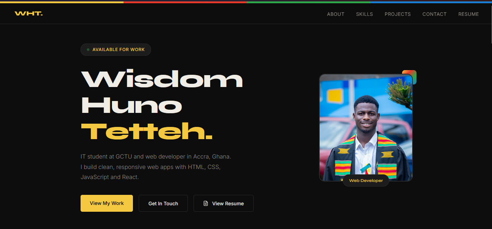
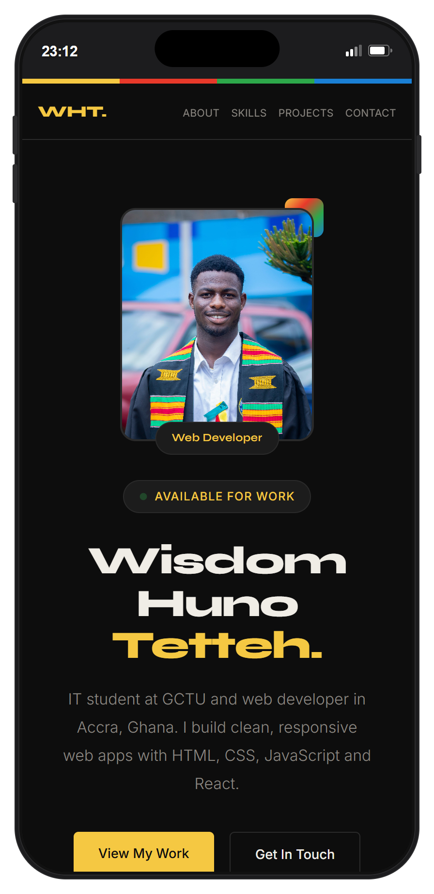

# Wisdom Huno Tetteh — Portfolio

A responsive personal portfolio for **Wisdom Huno Tetteh**, an IT student and web developer based in Accra, Ghana. This project was built for CodeAlpha Internship Task 3: Build Your Own Portfolio Site.

[Live Demo](https://codealphapersonalportfolio.vercel.app/) · [Source Code](https://github.com/brah14/CodeAlpha_PersonalPortfolio)

## Preview

<p align="center">
  
</p>

<p align="center">
  
</p>

## Features

- Responsive layout for mobile, tablet, and desktop screens
- Clear Hero, About, Skills, Projects, Resume, and Contact sections
- Real project screenshots linked to live demos and GitHub repositories
- Smooth anchor navigation, scroll-reveal effects, and interactive hover states
- One-time staggered hero entrance animation with reduced-motion support
- Embedded PDF resume page with a separate download option
- Contact form powered by Formspree
- Accessible mobile navigation, keyboard focus styles, and skip-to-content link
- Kente-inspired colour palette and Lucide icons

## Built With

- HTML5
- CSS3 — custom properties, Flexbox, Grid, responsive media queries, and animations
- Vanilla JavaScript — Intersection Observer, mobile navigation, and Fetch API
- [Lucide](https://lucide.dev) — icons
- [Formspree](https://formspree.io) — contact form handling

## Project Structure

```text
CodeAlpha_PersonalPortfolio/
├── index.html                         # Main portfolio page
├── resume.html                        # In-site PDF resume viewer
├── style.css                          # Styling, animations, and responsive rules
├── script.js                          # Navigation, scroll effects, and contact form logic
├── AK9A0346.jpg                       # Profile image
├── Wisdom_Huno_Tetteh_Resume.pdf      # Downloadable resume
├── assets/
│   ├── calculator-thumbnail.png       # Calculator project screenshot
│   ├── image-gallery-thumbnail.png    # Image Gallery project screenshot
│   ├── invoisory-thumbnail.png        # Invoisory project screenshot
│   └── screenshots/                   # README preview images
└── README.md
```

## Run Locally

1. Clone the repository.

   ```bash
   git clone https://github.com/brah14/CodeAlpha_PersonalPortfolio.git
   ```

2. Open the project folder.

   ```bash
   cd CodeAlpha_PersonalPortfolio
   ```

3. Open `index.html` in your browser, or use a local development extension such as VS Code Live Server.

No packages or build tools are required.

## Live Deployment

The portfolio is deployed on Vercel:

[https://codealphapersonalportfolio.vercel.app/](https://codealphapersonalportfolio.vercel.app/)

## Contact

- GitHub: [@brah14](https://github.com/brah14)
- LinkedIn: [Wisdom Huno Tetteh](https://www.linkedin.com/in/wisdom-huno-tetteh-6aa8853ab)
- Email: [hunowisdom14@gmail.com](mailto:hunowisdom14@gmail.com)

## Author

**Wisdom Huno Tetteh**
